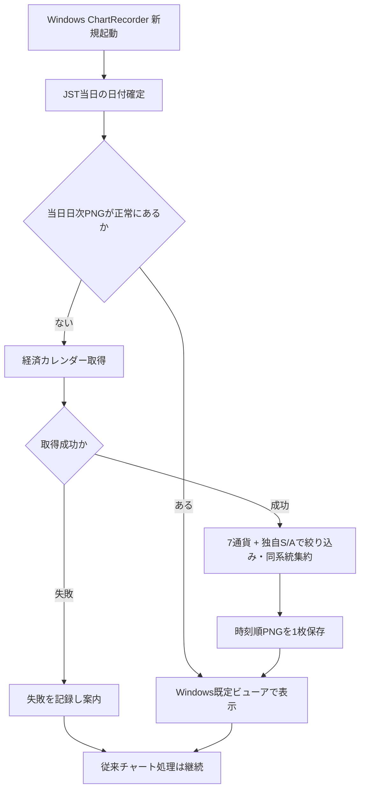

# 図・受け入れ条件

## ECO-010 フロー

## 受け入れ条件
| ID | テスト | 合格条件 |
|---|---|---|
| ECO-AC-001 | Windows新規起動・当日PNGなし | 指標取得→PNG1枚→既定ビューア表示 |
| ECO-AC-002 | 同日再起動・有効PNGあり | API不要、同じ1枚を再表示 |
| ECO-AC-003 | JST日付跨ぎ | 新しい日付のPNGを生成。前日画像を当日と混同しない |
| ECO-AC-004 | 7通貨+その他の混在 | 7通貨のS/Aのみ表示。他通貨を含めない |
| ECO-AC-005 | 重要度の不一致 | TradingView等で低重要度でもマスターSなら表示 |
| ECO-AC-006 | 複数の雇用内訳・政策系発表 | 同一イベントは集約、異なる発表時刻は保全 |
| ECO-AC-007 | UTC/JST日境界・夏時間 | JST 00:00〜24:00の範囲が正しい |
| ECO-AC-008 | 前回/予想/結果に欠測 | 欠測を0としない。提供される値は単位を維持 |
| ECO-AC-009 | 正常取得したが0件 | 0件と分かる当日日次PNGを1枚作成 |
| ECO-AC-010 | API失敗・認証切れ | 空予定として偽表示しない、チャート取得継続 |
| ECO-AC-011 | 既定ビューア起動不可 | PNG保存は成功し、障害が記録される |
| ECO-AC-012 | チャート最大10フォルダ保持 | `daily_events`を削除対象にしない |
| ECO-AC-013 | 二重起動時「いいえ」 | 既存アプリ継続・余計な日次取得/ビューア起動なし |
| ECO-AC-014 | 既存Saxo 13ペア×9時間足 | 従来の取得・画像出力に回帰なし |
| ECO-AC-015 | 画面の目視 | 日本語・時刻・S/A・行の判読性、レイアウト承認 |
| ECO-AC-016 | 情報セキュリティ | PNG・ログ・GitHubに認証情報なし |
| ECO-AC-017 | 外部API利用可否 | 自動利用・権利・料金・レート制限を確認し、利用不能なら実装停止 |

## 試験上の注意
- ここに記載した条件は**予定する試験**であり、実施済みのPASSではない。
- Windows実機でビューア起動・常駐状態・二重起動、認証/接続失敗を確認する。
- 旧仕様のチャート取得5分/10フォルダ/Saxo再認証を変えないことを必ず回帰テストする。

## ECO-011 YAML判定の追加受入条件
- 同じマスター版・同じ入力イベントは、繰り返しても同じS/A/REVIEWと同じグループIDを得る。
- AUD `Employment Change`、`Unemployment Rate`、`Full Time Employment Chg`は、配信元が重要度中でも`AU_EMPLOYMENT/S`へ集約。
- GBP `GDP MoM`と`GDP 3-Month Avg`は`GB_GDP/A`へ集約。
- USD `PPI MoM`と`Core PPI MoM`は`US_PPI/A`、`Retail Sales MoM`は`US_RETAIL/A`。
- 一般委員の`Fed Bowman Speech`や`BoJ Koeda Speech`を、総裁・議長に推定してSにしない。
- 異なる国(EUとDE等)の同名指標を誤統合せず、国不明ならREVIEW。
- 指標ID、別名（通貨と対象国込み）、ランクの重複・競合は設定エラー。
- 判定マスター変更時はpolicy_version更新を必須とし、テスト差分を確認する。

上記は実装の**受け入れ条件**であり、現時点の試験PASSを意味しない。
